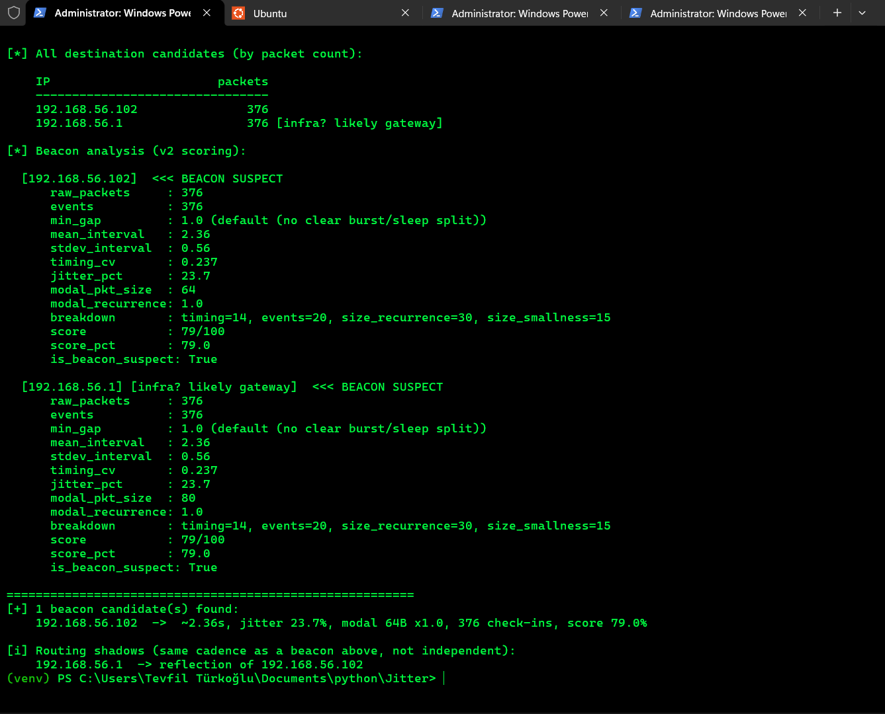
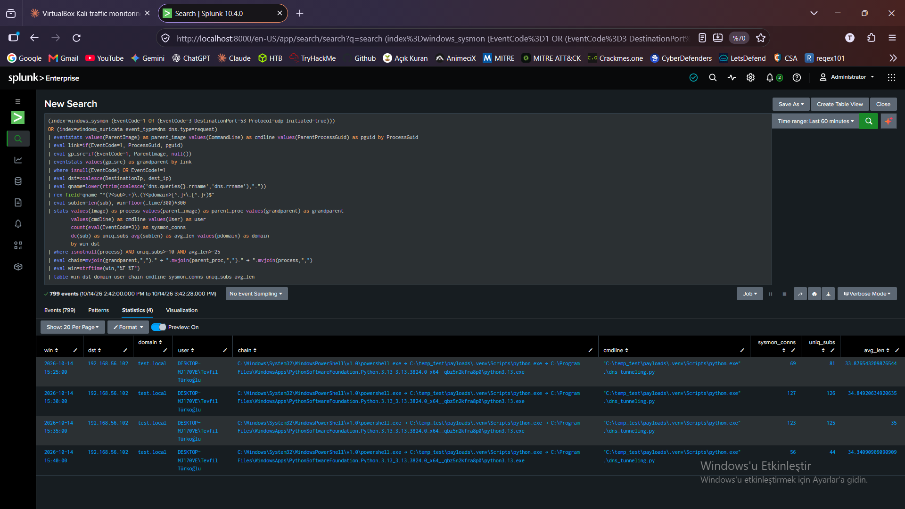

# DET0400 — Behavioral Detection of DNS Tunneling (T1071.004 / T1048.003)

## 1. Scenario

DNS is allowed outbound almost everywhere, so it is a common covert channel. Data hides in the **query name**; the attacker's server only needs to receive the question. No single query looks wrong — one 35-character label is indistinguishable from a CDN hostname. What is anomalous is the **aggregate**: hundreds of unique, long, high-entropy subdomains under one parent domain, from one process, on a near-regular clock.

MITRE's detection strategy for this behaviour, **DET0400**, is built on the same observation and splits it by what the sensor can see:

| Analytic | Platform | What it looks for | Covered here |
|---|---|---|---|
| **AN1121** | Windows | High-frequency or anomalous DNS from non-browser, non-system processes (PowerShell, rundll32, python.exe) | ✅ §7 (Sysmon EID 3) |
| **AN1122** | Linux | Daemons/scripts with long or frequent subdomains (iodine, dnscat2, dig from cron) | ⬜ out of scope — no Linux client in lab |
| **AN1123** | macOS | Scripting environments with encoded subdomains | ⬜ out of scope |
| **AN1124** | Network | Clients with high volume, long labels, encoded patterns, known-bad infrastructure | ✅ §5–6 (Suricata + Splunk); the "known-bad infrastructure" clause is not implementable on `test.local` |
| **AN1125** | ESXi | Unusual outbound DNS from hypervisor hosts | ⬜ out of scope |

The key design point in the strategy is that **no single signal carries it**: AN1124 combines volume, length and encoding, and AN1121 adds *which process* made the query. This writeup builds both and then correlates them.

A lab-generated tunnel (synthetic data, Windows host → Kali) produced all telemetry. The writeup covers detection only, and documents every defect found along the way — including several in my own first-draft detections.

---

## 2. Lab Setup

| Component | Detail |
|---|---|
| DNS server (Kali) | `192.168.56.102`, VirtualBox Host-Only adapter, answers authoritatively for `test.local` |
| Query source | Windows 11 host `DESKTOP-MJ170VE`, `192.168.56.1` |
| Network sensor | Suricata on the Windows host, Npcap, *VirtualBox Host-Only Ethernet Adapter* |
| Endpoint sensor | Sysmon v15.20 (schema 4.91), SwiftOnSecurity config v74 (schema 4.50) |
| SIEM | Splunk Enterprise 10.4.0 — `index=windows_suricata` (eve.json), `index=windows_sysmon` |
| Timing tool | `beacon-hunter.py` (v2 scoring) |
| Client runtime | Python 3.13 installed from the Microsoft Store, run inside a venv |

### 2.1 Capture point

| VirtualBox mode | Host-side capture works? |
|---|---|
| **Host-Only** | **Yes** — dedicated virtual adapter |
| NAT | No — handled inside the VirtualBox process |
| Bridged | Unreliable — host ↔ guest traffic may bypass the physical adapter |
| Internal Network | No |

```powershell
Get-NetAdapter | Format-Table Name, InterfaceDescription, InterfaceGuid, Status
.\suricata.exe -c .\suricata.yaml -i "\Device\NPF_{A73CABAC-5A25-4549-88EE-FE81B84EF150}" -l "C:\Program Files\Suricata\log" -k none -v
```

> **Note:** `-k none` matters when the sender and the sensor are the same machine. Host-originated packets are captured before NIC checksum offload, look invalid to Suricata, and can be skipped before rule evaluation — the classic "traffic flows but no alert fires".

---

## 3. What the Telemetry Looks Like

Three runs of the same activity appear in the data:

| Run | Window (local) | Queries | Interval | Sensors with coverage |
|---|---|---|---|---|
| A | 10-13 19:57:46 – 19:57:56 | 20 | 0.5 s, fixed (`gap_cv = 0`) | Suricata |
| B | 10-13 20:14:08 – 20:28:52 | 376 | 1.44 – 3.35 s, median 2.34 s (jittered) | Suricata |
| C | 10-14 14:15 – 14:30 | 376 | jittered | Suricata + Sysmon |

Capture-level facts for run B (837 packets, 888 s):

| Metric | Value |
|---|---|
| Unique query names | 376 of 376 (ratio **1.00**) |
| Parent domains | 1 |
| Label length | 35 × 275, 34 × 90, 33 × 10, 6 × 1 (short final label) |
| Label shape | `p<counter>-<30 base64url characters>` |
| Throughput | ≈ 9.5 bytes/s |
| Responses | all `NOERROR`, one identical answer |

Three properties that shape detection:

1. **Labels are not 4-aligned** (30 mod 4 = 2), so a label cannot be decoded on its own — an analyst must concatenate in counter order first.
2. **The alphabet is base64url with padding stripped** (`-` and `_`, never `+`, `/` or `=`). 8 of 376 labels contain `_`; any regex character class written for standard base64 mishandles them (§5.3).
3. **Requests and responses are separate events.** 10 queries produce 20 Suricata `dns` events. Every detection filters on `dns.type=request`, otherwise counts double.

The response content is irrelevant — the signal is on the request side, so NXDOMAIN-rate or TXT-size detections do nothing here.

---

## 4. Layer 1 — Timing: `beacon-hunter.py`

```
python .\beacon-hunter.py C:\temp_test\dns-tunneling.pcapng --include-internal
```



| Field | `192.168.56.102` |
|---|---|
| Packets / events | 376 / 376 |
| Mean interval / stdev | 2.36 s / 0.56 s |
| Jitter | 23.7 % (`timing_cv` 0.237) |
| Breakdown | timing 14, events 20, size_recurrence 30, size_smallness 15 |
| Score | **79 / 100** — beacon suspect |

`192.168.56.1` scores identically and is correctly labelled a **routing shadow** (reflection of the same flows), so one candidate is reported: the tunnel server.

**Reading the result.** The tool catches the channel, but through the weakest signal available. Jitter of 23.7 % holds the timing component to 14 points, and the total of 79 leaves little margin: a tunnel with more jitter would score lower still. Timing is the signal an operator controls most cheaply; the structure of the query names is not. The sender's configured jitter is a uniform ±40 % around a ~2.4 s base delay, which reproduces the observed 1.44–3.35 s range exactly.

**Open item:** `modal_pkt_size = 64` with `modal_recurrence = 1.0` is surprising when label length varies between 33 and 35. The tool probably buckets sizes; verify before trusting the size component.

---

## 5. Layer 2 — Signature: Suricata

### 5.1 Rule (as tested live)

```
alert dns any any -> any any (msg:"LAB DNS tunnel - sequenced base64 chunk"; dns.query; pcre:"/^p\d{1,4}-[A-Za-z0-9+\/=]{20,}\./"; threshold:type both, track by_src, count 20, seconds 120; sid:1000002; rev:1;)
```

`threshold: type both` alerts once per 120 s window after 20 matches, so a 376-query run does not produce 376 alerts.

> **Scope of this rule.** The `p<counter>-` prefix is specific to this tool. It is a *signature for the lab's tunnel*, not a general detection — a different tunnelling tool will not use that prefix. Its role is to prove the pipeline end to end and to act as a corroborating signal in §8. General detection lives in the aggregation layers, because a per-packet engine cannot count unique names per parent domain or compute entropy.

### 5.2 Live validation — full-length run (run C)

The rule file was added to `rule-files`, Suricata restarted (rules load only at startup), and the full 15-minute run executed.


```spl
index=windows_suricata event_type=alert alert.signature_id=1000002
| table _time src_ip dest_ip alert.signature
```

| Alert | Time (local) | Δ from first | Replay prediction Δ |
|---|---|---|---|
| 1 | 14:16:40 | — | — |
| 2 | 14:18:40 | 120 s | 121 s |
| 3 | 14:20:39 | 239 s | 247 s |
| 4 | 14:22:41 | 361 s | 363 s |
| 5 | 14:24:42 | 482 s | 484 s |
| 6 | 14:26:44 | 604 s | 603 s |
| 7 | 14:28:50 | 730 s | 729 s |

**Seven alerts, ~2 minutes apart**, matching an offline replay of the capture timestamps through the `count 20 / seconds 120` logic to within 8 s at every alert. An earlier run that was stopped by hand after the first alert had produced exactly one — consistent with the same behaviour.

### 5.3 Defect found: character class too narrow

Replaying run B offline against the rule's regex:

| Variant | Queries matched (of 376) |
|---|---|
| As tested `[A-Za-z0-9+\/=]` | 367 |
| Fixed `[A-Za-z0-9_-]` | 375 |

Eight labels contain `_` and fail the pattern; the ninth miss is the short final label (< 20 characters), which fails both. The live run still produced seven alerts because every 120 s window held well over 20 matches — the gap undercounts silently, and a slower tunnel could fall under the threshold because of it.

### 5.4 Hardened rule (`rev:2`, validated live — §5.5)

```
alert dns any any -> any any (msg:"LAB DNS tunnel - sequenced chunk labels"; flow:to_server; dns.query; pcre:"/^p\d{1,4}-[A-Za-z0-9_-]{20,}\./"; threshold:type both, track by_src, count 20, seconds 120; sid:1000002; rev:2;)
```

- Character class matches the tool's actual alphabet (base64url, no padding).
- `flow:to_server` prevents the same query name inside a *response* from being counted again on versions where `dns.query` also inspects responses.

> **A "long label" rule is not a substitute.** A generic variant (`bsize:>40` plus a 30-character label pattern) catches this traffic but also CDN, tracking and AV-reputation hostnames. Length is a consequence of tunnelling, not its definition; DET0400 requires volume and encoding alongside it. That judgement belongs in the aggregation layer.

### 5.5 Validation of `rev:2`

**Pcap replay, per-query match** (threshold removed, `-S` with a single rule, `-k none`): 375 alerts for 376 queries. The alert set is identical to the set obtained by applying the same regex to every request in the capture. The one query that does not match is the final chunk, `p375-U.test.local` — a one-character label, below the `{20,}` minimum. That is an accepted trade-off: the minimum length keeps short, ordinary labels out of the rule, and 375 matches clears the threshold of 20 by a wide margin.

**Live run** (fresh 376-chunk run, `alert.rev` = 2 in every event):

| # | Alert time | Triggering query | Gap |
|---|---|---|---|
| 1 | 15:27:36 | p19 | — |
| 2 | 15:29:28 | p67 | 112 s |
| 3 | 15:31:28 | p118 | 120 s |
| 4 | 15:33:30 | p170 | 122 s |
| 5 | 15:35:33 | p222 | 123 s |
| 6 | 15:37:39 | p271 | 126 s |
| 7 | 15:39:33 | p319 | 114 s |
| 8 | 15:41:33 | p373 | 120 s |

Eight alerts, ~2 minutes apart: one per `seconds 120` window, each firing on the 20th match, as `type both` specifies. The cadence is the same as `rev:1`'s, so the wider character class changes coverage, not alert volume.

> **Replay caveat.** A threshold replay of the same pcap with the default multi-threaded runmode (8 workers) produced only 5 alerts, irregularly spaced (135–181 s) and written to `eve.json` out of chronological order. Every query is a new flow, so packets are spread across workers and reach the `by_src` window out of order. The live result matches the model (window logic applied to the capture timestamps predicts 7 over the capture's length), which points to replay ordering as the cause; a `--runmode=single` replay has not been run to confirm it. Treat threshold behaviour from multi-threaded replays as unreliable and use the live run as the reference.

---

## 6. Layer 3 — Network Behaviour: Splunk (AN1124)

### 6.1 Signals

| Signal | Run B value | Why it separates tunnelling from normal DNS |
|---|---|---|
| `uniq_subs` / `uniq_ratio` | 376 / 1.00 | Normal clients re-query the same names; ratio rarely approaches 1.0 over hundreds of queries |
| `avg_len` | 34.4 | Typical hostnames are 10–15 characters |
| `len_stdev` | 0 – 2.9 | Chunked payload → near-constant label length |
| `gap_cv` | 0.24 (run A: 0.00) | Regular cadence; informational only, because jitter defeats it |

The detection filters on structure (`uniq_subs`, `uniq_ratio`, `avg_len`), not timing. Run A (fixed 0.5 s) and run B (jittered) are both caught by the same rule, which is the argument for weighting structure over timing in `beacon-hunter.py` as well.

### 6.2 Iterations

The first version scored per 5-minute window and printed one row per window:

| win start | queries | uniq_subs | avg_len | avg_gap | gap_cv | first → last |
|---|---|---|---|---|---|---|
| 19:55 | 20 | 20 | 33.1 | 0.50 | 0.00 | 19:57:46 → 19:57:56 |
| 20:10 | 21 | 21 | 33.5 | **48.67** | **4.35** | 20:14:08 → 20:14:58 |
| 20:15 | 128 | 128 | 34.4 | 2.35 | 0.24 | 20:15:00 → 20:19:58 |
| 20:20 | 127 | 127 | 35.0 | 2.37 | 0.24 | 20:20:00 → 20:24:59 |
| 20:25 | 100 | 100 | 34.7 | 2.33 | 0.24 | 20:25:01 → 20:28:52 |

Three defects:

1. **`gap_cv` artefact (20:10 row).** `streamstats` ran across the whole search, so the first event of the window inherited the ~16-minute gap to run A (975 s / 20 ≈ 48.7). Fix: compute `win` first and run `streamstats ... by src_ip parent win`, so the first event of every window has a null gap.
2. **One campaign, four alerts.** Run B spans four consecutive windows. Fix: merge windows ≤ 600 s apart into one *campaign* with a second `streamstats` over `win`.
3. **Run A sat exactly on the threshold.** `uniq_subs >= 20` and run A produced exactly 20 — a 19-query run would have been missed. Threshold lowered to 10, with `uniq_ratio >= 0.9` and `avg_len >= 25` keeping false positives down.

> **Sampling lesson.** The first Splunk export contained only the last 10 queries of run A (a 0.5 s cadence), while the capture held all 376 of run B (≈2.3 s, jittered). Characterising timing from the partial export gave the wrong cadence. Check that a sample covers the whole activity before describing its timing.

### 6.3 Final query

```spl
index=windows_suricata event_type=dns dns.type=request
| eval qname=lower(rtrim(coalesce('dns.queries{}.rrname','dns.rrname'),"."))
| rex field=qname "^(?<sub>.+)\.(?<parent>[^.]+\.[^.]+)$"
| where isnotnull(sub)
| sort 0 src_ip parent _time
| eval win=floor(_time/300)*300
| streamstats current=f last(_time) as prev by src_ip parent win
| eval gap=_time-prev, sublen=len(sub)
| stats count dc(sub) as uniq_subs avg(sublen) as avg_len stdev(sublen) as len_stdev
        avg(gap) as avg_gap stdev(gap) as gap_stdev
        min(_time) as first_seen max(_time) as last_seen
        by win src_ip parent
| eval uniq_ratio=round(uniq_subs/count,2), gap_cv=round(gap_stdev/avg_gap,2)
| where uniq_subs>=10 AND uniq_ratio>=0.9 AND avg_len>=25
| sort 0 src_ip parent win
| streamstats current=f last(win) as prev_win by src_ip parent
| eval new_campaign=if(isnull(prev_win) OR win-prev_win>600,1,0)
| streamstats sum(new_campaign) as campaign by src_ip parent
| stats sum(count) as queries avg(uniq_ratio) as uniq_ratio avg(avg_len) as avg_len
        avg(gap_cv) as gap_cv min(first_seen) as first_seen max(last_seen) as last_seen
        by src_ip parent campaign
| eval duration_s=round(last_seen-first_seen), first_seen=strftime(first_seen,"%F %T"), last_seen=strftime(last_seen,"%F %T")
| fields src_ip parent queries uniq_ratio avg_len gap_cv duration_s first_seen last_seen
| sort - queries
```

### 6.4 Observed output


| src_ip | parent | queries | uniq_ratio | avg_len | gap_cv | duration_s | first_seen | last_seen |
|---|---|---|---|---|---|---|---|---|
| 192.168.56.1 | test.local | **376** | 1 | 34.40 | 0.235 | 884 | 20:14:08 | 20:28:52 |
| 192.168.56.1 | test.local | 20 | 1 | 33.1 | 0 | 10 | 19:57:46 | 19:57:56 |

Two campaigns from one source to one domain: a 10-second test and a 15-minute transfer. The query count sums to 396 = 376 + 20, so no events were lost in the merge.

**Scheduling.** As an alert: search window ≥ 30 min, with `alert.suppress.fields = src_ip,parent` and `alert.suppress.period = 30m`, otherwise a long campaign fragments across runs.

### 6.5 Daily-window variant (slow tunnels)

The 5-minute query cannot fire on a tunnel that sends ~10 queries an hour. The same signals over a 24-hour window, with the time dimension replaced by the number of distinct active hours:

```spl
index=windows_suricata event_type=dns dns.type=request earliest=-24h
| eval qname=lower(rtrim(coalesce('dns.queries{}.rrname','dns.rrname'),"."))
| rex field=qname "^(?<sub>.+)\.(?<pdomain>[^.]+\.[^.]+)$"
| where isnotnull(sub)
| eval sublen=len(sub), hour=floor(_time/3600)*3600
| stats count dc(sub) as uniq_subs avg(sublen) as avg_len dc(hour) as active_hours
        min(_time) as first_seen max(_time) as last_seen by src_ip pdomain
| where uniq_subs>=8 AND avg_len>=25 AND active_hours>=6
| eval per_hour=round(count/active_hours,1)
```

**Validation.** The threshold logic was exercised with synthetic events (12 unique 33-character labels spread over 12 hours → one row). On real data, running the aggregation unfiltered over the last 24 hours returned `test.local` with 1,179 queries, 396 unique names, `avg_len` 34.6 and 4 active hours (several runs across two days), while every other domain from the host's second interface had `avg_len` ≤ 16.1 and was removed by the length condition alone. So extraction on real Suricata fields works. A 24-hour run of the real tunnel at a low rate was **not** done; `active_hours>=6` is therefore an untested threshold, to be calibrated against a baseline.

**Design lesson — no `uniq_ratio` in the daily window.** My first version kept `uniq_ratio>=0.9` from the 5-minute query and returned nothing: the script sends the same payload on every run, so the same 376 names repeat across runs and the ratio fell to 0.34 (396 unique / 1,179 queries). Re-sending the same data is exactly what a persistent exfiltration channel does, so a ratio threshold would let it through. The daily rule uses the *count* of unique names, label length and the spread across hours instead.

---

## 7. Layer 4 — Endpoint: Process Attribution (AN1121)

The network layers say *a tunnel exists*. AN1121 asks the question an analyst needs next: **which process made the queries.**

### 7.1 Sysmon EID 22 is blind to this client

The obvious source is Sysmon EID 22 (DnsQuery). It returned nothing for the run. EID 22 is fed by the Windows DNS Client service; a client that opens its own UDP socket to a chosen nameserver never touches that service, so no EID 22 is produced. This is a property of the *client class* (any DNS library configured with an explicit nameserver), not a configuration fault, and it will recur for real tooling.

### 7.2 Sysmon EID 3 — and three obstacles

The alternative is EID 3 (NetworkConnect) with `DestinationPort=53`. Sysmon logs UDP — proven by existing `Code.exe → UDP/53` events in the baseline. Getting the tunnel's own events took three corrections:

| # | Symptom | Cause | Fix |
|---|---|---|---|
| 1 | `Sysmon64.exe -c \| Select-String "python"` returned nothing, suggesting the new rules were not loaded | The configuration dump is not captured by a pipe | Do not infer config state from it; the dump later showed `python.exe`, `pythonw.exe`, `curl.exe` in the include list, and the service was running |
| 2 | Edited XML had no effect | Sysmon does not re-read the file; the new rules were added after the last `-c <file>` | Apply with `Sysmon64.exe -c .\sysmonconfig-export.xml` ("Configuration updated"), then **re-run** — events are not back-filled |
| 3 | Still no EID 3 for the script | The connection is not opened by the process that was launched | See below |

**The Image-name trap.** The process tree for the run (EID 1) was:

```
powershell.exe
  └─ C:\temp_test\payloads\.venv\Scripts\python.exe            ← venv launcher
       └─ C:\Program Files\WindowsApps\PythonSoftwareFoundation.Python.3.13_...\python3.13.exe   ← opens the socket
```

The SwiftOnSecurity NetworkConnect rule is `Image condition="image" python.exe` — an exact **file-name** match. The process that opens the socket is `python3.13.exe` under `Program Files\WindowsApps`, which matches neither that rule nor the `C:\Users` prefix rule. The launcher that *does* match never makes a network connection. Fix:

```xml
<Image name="Python interpreter (any name)" condition="contains">\python</Image>
```

> **Lesson.** A detection keyed on an executable's *name* is blind to Store Python, renamed interpreters, and any launcher/child split. The process that starts a script and the process that opens its socket can differ; match on path patterns or the process tree.

### 7.3 Validation

After applying the rule and re-running:

```spl
index=windows_sysmon EventCode=3 DestinationIp=192.168.56.102
| stats count dc(SourcePort) as sockets by Image, DestinationPort, Protocol, Initiated
```

| Image | Port | Proto | Initiated | count | sockets |
|---|---|---|---|---|---|
| `...\python3.13.exe` | 53 | udp | true (request) | 13 | 13 |
| `...\python3.13.exe` | 53 | udp | false (response) | 7 | 7 |

`sockets = count`: every query uses a new source port. That is itself a signal — a normal resolver multiplexes many queries over few sockets.

### 7.4 AN1121 detection

```spl
index=windows_sysmon EventCode=3 DestinationPort=53 Protocol=udp Initiated=true
| search NOT Image IN ("*\\svchost.exe","*\\chrome.exe","*\\msedge.exe","*\\firefox.exe","*\\Code.exe")
| bin _time span=5m
| stats count dc(SourcePort) as sockets dc(DestinationIp) as resolvers values(DestinationIp) as dst by _time, Image, User
| eval sockets_per_query=round(sockets/count,2)
| where count>=10 AND sockets_per_query>=0.9
```

Output (short test run, 13:40 window): `python3.13.exe`, 20 connections, 20 sockets, `sockets_per_query = 1.00`, one destination (`192.168.56.102`).

Browsers and Electron apps are excluded on purpose: `Code.exe` also sends UDP/53 directly, to the configured resolver. "Bypasses the Windows resolver" is therefore **not** suspicious by itself; a non-browser process doing it at volume, with one socket per query, is.

---

## 8. Correlation: Process × Query Structure

Both sensors see the same hop to `192.168.56.102`, so the destination IP joins them: Sysmon supplies *who*, Suricata's `dns` events supply *what was asked*.

EID 3 alone only names the process that opened the socket — here the interpreter, not what launched it. To make the alert actionable, Sysmon EID 1 (ProcessCreate) is joined on `ProcessGuid`, and one hop further up through `ParentProcessGuid`, so the alert carries the launch chain and the command line.

[DNS Tunneling SPL Query](../../Rules/Splunk-SPL/Command-and-Control/dns-tunnelling.spl)

How the enrichment works:

- The first `eventstats` copies each process's `ParentImage`, `CommandLine` and parent GUID from its EID 1 row onto its EID 3 rows (same `ProcessGuid`).
- `link` + the second `eventstats` repeat the step one level up: the parent's own EID 1 row supplies *its* `ParentImage` — the grandparent.
- EID 1 rows are then dropped; the rest is the network × process correlation.

The search time range must **include the process start** (EID 1 is written when the script launches), otherwise `chain` and `cmdline` come back empty.

Run C output (all four windows carry the same chain and command line):

```
chain : C:\Windows\System32\WindowsPowerShell\v1.0\powershell.exe
        → C:\temp_test\payloads\.venv\Scripts\python.exe
        → C:\Program Files\WindowsApps\PythonSoftwareFoundation.Python.3.13_...\python3.13.exe
cmdline: "C:\temp_test\payloads\.venv\Scripts\python.exe" .\dns_tunneling.py
user   : DESKTOP-MJ170VE\Tevfil Türkoğlu
```

| win | dst | domain | sysmon_conns | uniq_subs | avg_len |
|---|---|---|---|---|---|
| 14:15 | 192.168.56.102 | test.local | 119 | 106 | 33.96 |
| 14:20 | 192.168.56.102 | test.local | 129 | 128 | 35 |
| 14:25 | 192.168.56.102 | test.local | 123 | 123 | 35 |
| 14:30 | 192.168.56.102 | test.local | 30 | 19 | 33.47 |


One row now answers what neither sensor could alone: *this user ran this script, from PowerShell through a venv launcher, and the process it spawned sent N unique, ~35-character subdomains of `test.local` to this server in this window.* The analyst gets the script name and the launch chain without leaving the alert — which the interpreter path alone (`python3.13.exe` under `WindowsApps`) does not provide.

**Reconciliation.** `uniq_subs` sums to 106 + 128 + 123 + 19 = **376**, exactly the number of chunks. `sysmon_conns` sums to 119 + 129 + 123 + 30 = **401** — 25 more connections than unique names. (An earlier read, taken before the 14:30 window had closed, showed 26 for that window, i.e. 397 in total.) My first explanation was client-side retries of the same name after a timeout (identical `sub`, extra socket).

**Re-check on a fresh run.** Counting request names in the Suricata data: 376 queries, 376 distinct names, **0 repeated** — so retries are rejected as the cause, at least for this run. The same correlation on the new run gives:

| Window | `sysmon_conns` | `uniq_subs` |
|---|---|---|
| 15:25 | 69 | 81 |
| 15:30 | 127 | 126 |
| 15:35 | 123 | 125 |
| 15:40 | 56 | 44 |
| **Total** | **375** | **376** |




Here the totals agree to within one (375 connections for 376 queries), and the chain and command line are identical to the earlier run. The +25 from the first run did not reproduce, and I did not find its cause. The per-window differences (−12 in the first window, +12 in the last, ≈ 0 between) have the shape of a roughly 30-second offset between the Sysmon and Suricata timestamps, which would push ~12 events across each 5-minute edge. That is a hypothesis, not a measurement; either way, fixed windows joined across two sensors tolerate a small clock offset only if the thresholds sit well below the window's volume.

Windows 14:15–14:30 are one campaign; as an alert it needs the same ≤ 600 s merge and `dst`+`process` suppression as §6.

> **Join limits.** The join works when both sensors see the same hop (here: client-side Suricata and Sysmon on the same host). A Suricata sensor on the internet side sees the resolver → attacker leg, whose destination differs from the Sysmon destination, so the join would not match.

---

## 9. Where `src_ip` Points: Client vs Resolver

In this lab the host asks the Kali server directly, so `src_ip = 192.168.56.1` *is* the machine running the tool.

In a real network clients ask an internal resolver, and the resolver asks outward:

```
client 10.0.5.23 ──► resolver 10.0.0.53 ──► internet ──► attacker NS
```

A sensor on the **internet side** only ever sees `10.0.0.53` as `src_ip`, so a network-only alert names the intermediary, not the infected host. Two ways to recover the client:

1. **Pivot to resolver logs** (Windows DNS debug log, BIND query log) and search for the flagged parent domain — the client IP is recorded there.
2. **Sense on the client side** of the resolver, or on the endpoint itself — which is exactly what AN1121 does: Sysmon runs on the machine that opened the socket, so attribution does not depend on where the network sensor sits.

Sensing at more than one point is the robust design.

---

## 10. False Positive Analysis

| Class | Fires on | Verdict |
|---|---|---|
| CDN / cloud hostnames (`*.cloudfront.net`, `*.akamaiedge.net`) | `avg_len`, `uniq_subs` | Benign. Allowlist by `parent`. |
| AV / reputation lookups (hash or IP encoded in the label) | all structure signals | Benign, but identical in shape to a tunnel. Allowlist by `parent`; review new ones. |
| Tracking / telemetry beacons with per-request IDs | `uniq_ratio`, `avg_len` | Benign. Usually recurring parents; baseline over 14 days. |
| Chromium/Electron apps sending UDP/53 directly | AN1121 process filter | Benign. Excluded by process; they target the configured resolver. |
| Laptop changes network | resolver-IP allowlists | The baseline resolver was `193.192.98.8` one day and `10.250.17.109` the next. **A fixed "approved resolver" list misfires on roaming hosts** — use process type and volume as the primary criteria, resolver IP as a secondary signal at most. |
| Slow tunnel (≈10 queries/hour) | none | **Missed** by the 5-minute window. Covered by the daily-window variant (§6.5); thresholds untested at a real low rate. |
| `.co.uk`-style parents | wrong `parent` grouping | Defect. The regex takes the last two labels; production needs a public-suffix lookup. |

---

## 11. DET0400 Mapping

| Analytic | Layer | Status |
|---|---|---|
| **AN1124** (network) | Suricata signature (§5) + Splunk aggregation (§6) | ✅ Validated on full run; "known-bad infrastructure" not implementable on a lab domain (needs reputation enrichment) |
| **AN1121** (Windows process) | Sysmon EID 3 + process filter (§7) | ✅ Validated; EID 22 shown blind for this client class |
| Correlation | Process × structure, with launch chain and command line via EID 1 (§8) | ✅ Validated on two runs; reproduced chain and 375/376 reconciliation on the second (the first run's +25 did not reproduce) |
| **AN1122 / AN1123 / AN1125** | — | ⬜ Out of scope |

| Technique | Relationship |
|---|---|
| [T1071.004](https://attack.mitre.org/techniques/T1071/004/) | Primary — application-layer protocol: DNS |
| [T1048.003](https://attack.mitre.org/techniques/T1048/003/) | Exfiltration over unencrypted non-C2 protocol |
| [T1132.001](https://attack.mitre.org/techniques/T1132/001/) | Data encoding — standard encoding in the labels |

---

