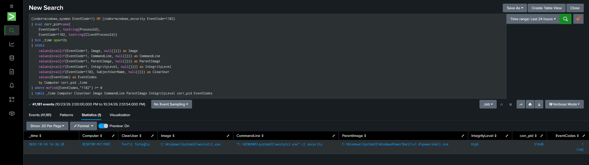
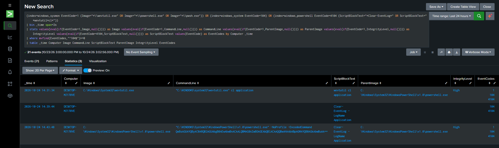

# T1070.001 · Clear Windows Event Logs

## 1. Scenario

The lab demonstrates Windows Event Log clearing as a defense-evasion technique. The attacker is assumed to already have elevated access to the endpoint and attempts to remove local audit evidence by clearing Windows event logs.

Three execution paths were tested:

- Native log clearing with `wevtutil.exe`
- PowerShell-native clearing with `Clear-EventLog`
- Encoded PowerShell execution using `-EncodedCommand`

The goal was not only to confirm that the logs were cleared, but also to determine which telemetry remains available after the action and how the different execution paths can be correlated in Splunk.

A key observation is that clearing the logs does not necessarily remove all evidence of the action. Windows generates dedicated log-clear events, while Sysmon and PowerShell telemetry can preserve the process and script execution context.

## 2. Lab Setup

| Component | Detail |
|---|---|
| Target system | Windows 11 lab endpoint |
| Endpoint telemetry | Sysmon EventCode 1, Windows Security EventCode 1102, System EventCode 104, PowerShell EventCode 4104 |
| Detection platform | Splunk |
| Sysmon index | `windows_sysmon` |
| Security index | `windows_security` |
| System index | `windows_system` |
| PowerShell index | `windows_powershell` |
| ATT&CK technique | T1070.001 — Clear Windows Event Logs |

## 3. Attack Chain

| Stage | Action | Evidence |
|---|---|---|
| 1. Clear Application log with native utility | Execute `wevtutil cl application` from an elevated PowerShell session | Sysmon EID 1 records `wevtutil.exe`; System EID 104 confirms that the Application log was cleared |
| 2. Clear Security log | Execute `wevtutil cl security` | Sysmon EID 1 records the process; Security EID 1102 records that the audit log was cleared |
| 3. Correlate Security clear event | Match `1102.ClientProcessId` with Sysmon `ProcessId` | The Security clear event was tied directly to the responsible `wevtutil.exe` process |
| 4. Test PowerShell-native clearing | Execute `Clear-EventLog -LogName Application` | PowerShell EID 4104 contains the script while EID 104 confirms the clear action |
| 5. Test encoded PowerShell | Launch a new PowerShell process using `-EncodedCommand` | Sysmon EID 1 records only the encoded command line; EID 4104 exposes the decoded `Clear-EventLog` script |
| 6. Build detection rules | Correlate log-clear confirmation events with process and PowerShell telemetry | Separate production-style detections were created for Security log clearing and other Windows log clearing |

## 4. Native `wevtutil` Behavior

The first test cleared the Application log:

```powershell
wevtutil cl application
```

Sysmon EventCode 1 recorded the process creation with the following context:

```text
Image:
C:\Windows\System32\wevtutil.exe

CommandLine:
"C:\WINDOWS\system32\wevtutil.exe" cl application

ParentImage:
C:\Windows\System32\WindowsPowerShell\v1.0\powershell.exe

IntegrityLevel:
High
```

Windows also generated System EventCode 104:

```text
Provider:
Microsoft-Windows-Eventlog

Event ID:
104

Message:
Application log file was cleared.
```

This confirms that Sysmon provides the execution context while EventCode 104 confirms that the requested log was actually cleared.

The Security log was then cleared:

```powershell
wevtutil cl security
```

Security EventCode 1102 was generated:

```text
EventCode:
1102

Name:
The audit log was cleared

SubjectUserName:
Tevfil Türkoğlu

ClientProcessId:
21648
```

The associated Sysmon event showed:

```text
ProcessId:
21648

Image:
C:\Windows\System32\wevtutil.exe

CommandLine:
"C:\WINDOWS\system32\wevtutil.exe" cl security

ParentImage:
C:\Windows\System32\WindowsPowerShell\v1.0\powershell.exe

IntegrityLevel:
High
```

The Sysmon process event occurred only a few milliseconds before the 1102 event, allowing the Security log clear event to be correlated directly with the responsible process.

## 5. PowerShell Behavior

The next test used the PowerShell-native cmdlet:

```powershell
Clear-EventLog -LogName Application
```

Because this command was executed inside an already-running PowerShell session, no new child process was created.

As a result:

```text
Sysmon EID 1:
Not generated for a new clearing process

PowerShell EID 4104:
Clear-EventLog -LogName Application

System EID 104:
Application log cleared
```

This explains why the `Image`, `CommandLine`, `ParentImage`, and `IntegrityLevel` fields remain empty for this execution path in the correlation output.

The behavior is still detected because EventCode 104 confirms the log clear and EventCode 4104 provides the PowerShell script context.

## 6. Encoded PowerShell Test

The PowerShell command was then encoded using UTF-16LE Base64:

```powershell
$cmd = 'Clear-EventLog -LogName Application'
$bytes = [System.Text.Encoding]::Unicode.GetBytes($cmd)
$enc = [Convert]::ToBase64String($bytes)
```

The encoded command was executed with:

```powershell
powershell.exe -NoProfile -EncodedCommand <BASE64>
```

Sysmon EventCode 1 recorded the process as:

```text
powershell.exe -NoProfile -EncodedCommand QwBsAGUAYQByAC0ARQB2AGUAbgB0AEwAbwBn...
```

The original script content was not visible in plaintext in the Sysmon command line.

However, PowerShell EventCode 4104 recorded the decoded script:

```text
Clear-EventLog -LogName Application
```

System EventCode 104 then confirmed that the Application log was actually cleared.

This produced the following telemetry chain:

```text
Sysmon EID 1
powershell.exe -EncodedCommand ...

        ↓

PowerShell EID 4104
Clear-EventLog -LogName Application

        ↓

System EID 104
Application log cleared
```

This demonstrates why PowerShell Script Block Logging is useful as enrichment when command-line content is encoded or otherwise difficult to interpret directly.

## 7. Detection Logic

The lab resulted in two separate production-style detection rules rather than one large correlation rule.

### Detection 1 — Security Audit Log Cleared

[Security Log Clear SPL](../../Rules/Splunk-SPL/Defense-Impairment/sec-log-clear.spl)


The first rule detects Security log clearing using Security EventCode 1102 and correlates it with Sysmon EventCode 1.

```spl
(index=windows_sysmon EventCode=1) OR (index=windows_security EventCode=1102)
| eval corr_pid=case(EventCode=1,tostring(ProcessId),EventCode=1102,tostring(ClientProcessId))
| bin _time span=2s
| stats values(eval(if(EventCode=1,Image,null()))) as Image values(eval(if(EventCode=1,CommandLine,null()))) as CommandLine values(eval(if(EventCode=1,ParentImage,null()))) as ParentImage values(eval(if(EventCode=1,IntegrityLevel,null()))) as IntegrityLevel values(eval(if(EventCode=1102,SubjectUserName,null()))) as ClearUser values(EventCode) as EventCodes by Computer corr_pid _time
| where mvfind(EventCodes,"1102")>=0
| table _time Computer ClearUser Image CommandLine ParentImage IntegrityLevel corr_pid EventCodes
```



The rule uses:

```text
1102.ClientProcessId
=
Sysmon EID 1.ProcessId
```

together with a narrow time window.

This is necessary because Windows process IDs can be reused over time. During testing, correlating solely on `Computer + ProcessId` caused unrelated historical processes such as Docker, Git, and Splunk components to be grouped with the log-clear event.

Adding the time constraint removed those false correlations.

### Detection 2 — Windows Event Log Cleared 

[Event Log Clear SPL](../../Rules/Splunk-SPL/Defense-Impairment/event-log-clear.spl)

The second rule detects EventCode 104 and enriches the result with Sysmon and PowerShell context.

```spl
(index=windows_sysmon EventCode=1 (Image="*\\wevtutil.exe" OR Image="*\\powershell.exe" OR Image="*\\pwsh.exe")) OR (index=windows_system EventCode=104) OR (index=windows_powershell EventCode=4104 (ScriptBlockText="*Clear-EventLog*" OR ScriptBlockText="*wevtutil*cl*"))
| bin _time span=2s
| stats values(eval(if(EventCode=1,Image,null()))) as Image values(eval(if(EventCode=1,CommandLine,null()))) as CommandLine values(eval(if(EventCode=1,ParentImage,null()))) as ParentImage values(eval(if(EventCode=1,IntegrityLevel,null()))) as IntegrityLevel values(eval(if(EventCode=4104,ScriptBlockText,null()))) as ScriptBlockText values(EventCode) as EventCodes by Computer _time
| where mvfind(EventCodes,"^104$")>=0
| table _time Computer Image CommandLine ScriptBlockText ParentImage IntegrityLevel EventCodes
```




The exact regular expression:

```spl
"^104$"
```

is used instead of:

```spl
"104"
```

because `mvfind` evaluates a regular expression. Without the anchors, PowerShell EventCode `4104` would also match the substring `104`, generating incorrect results.

## 8. Telemetry Roles

The lab showed that the telemetry sources have different responsibilities:

| Telemetry | Role |
|---|---|
| Sysmon EID 1 | Shows process creation, image path, command line, parent process, PID, and integrity level |
| Security EID 1102 | Confirms that the Security audit log was cleared |
| System EID 104 | Confirms that another Windows Event Log channel was cleared |
| PowerShell EID 4104 | Provides PowerShell script content, including decoded script blocks from encoded execution |

The primary confirmation events are therefore:

```text
1102 → Security log cleared
104  → Windows event log cleared
```

Sysmon and PowerShell telemetry provide execution context and enrichment.

## 9. Validation

The native Application log clear produced all expected telemetry:

```text
wevtutil cl application

Sysmon EID 1  → wevtutil.exe
PowerShell 4104 → wevtutil cl application
System EID 104 → Application log cleared
```

The native Security log clear produced:

```text
wevtutil cl security

Sysmon EID 1 → wevtutil.exe
Security EID 1102 → audit log cleared
```

`ClientProcessId` from EventCode 1102 matched the Sysmon `ProcessId`, allowing direct process correlation.

The PowerShell-native test produced:

```text
Clear-EventLog -LogName Application

PowerShell 4104 → Clear-EventLog -LogName Application
System EID 104 → Application log cleared
```

No new Sysmon EventCode 1 was generated because the cmdlet executed inside the already-running PowerShell process.

The encoded PowerShell test produced:

```text
Sysmon EID 1:
powershell.exe -EncodedCommand ...

PowerShell EID 4104:
Clear-EventLog -LogName Application

System EID 104:
Application log cleared
```

This confirmed that Script Block Logging provides decoded execution context even when Sysmon only observes an encoded command line.


## 11. Detection Design Decision

The lab intentionally uses two separate detections instead of one large query.

The Security log clear rule is based on EventCode 1102 because that event provides useful Security-specific fields such as `ClientProcessId` and `SubjectUserName`.

The general Windows Event Log clear rule is based on EventCode 104 and uses nearby Sysmon and PowerShell telemetry only as context.

This separation keeps each rule easier to understand, tune, and troubleshoot while both rules still map to the same ATT&CK technique.

## 12. Limitations

- The Security rule depends on EventCode 1102 being collected and forwarded before the event is lost locally.
- The EventCode 104 rule depends on the System event log being ingested into Splunk.
- Sysmon EventCode 1 only provides process context when a new process is created. PowerShell cmdlets executed inside an existing session may not generate a new process event.
- PowerShell EventCode 4104 depends on Script Block Logging being enabled.
- Base64 or encoded PowerShell can still be understood through 4104 only when the PowerShell logging configuration records the script block.
- PID correlation must include host and time context because Windows process IDs are reused.
- The current EventCode 104 correlation uses a two-second time bucket. Events close to a bucket boundary could theoretically be separated into different groups.
- EventCode 104 or 1102 confirms that a log was cleared but does not by itself prove malicious intent. Administrative maintenance or troubleshooting may produce legitimate clears.
- The lab validates `wevtutil`, `Clear-EventLog`, and encoded PowerShell execution. Other mechanisms such as direct `.evtx` manipulation were not tested.
- Centralized log forwarding is important because clearing the local event log does not remove events that have already been forwarded to Splunk.