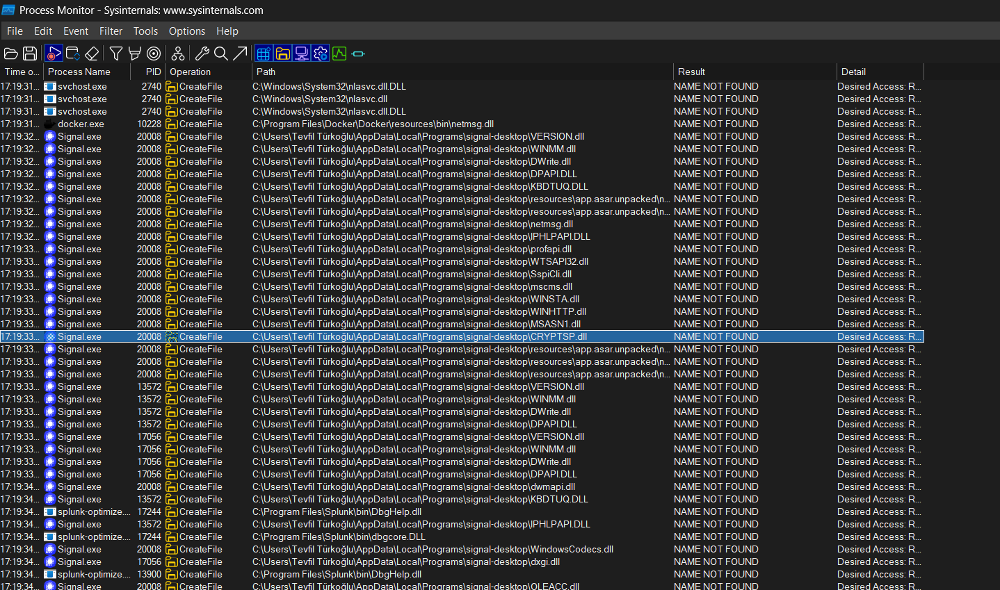
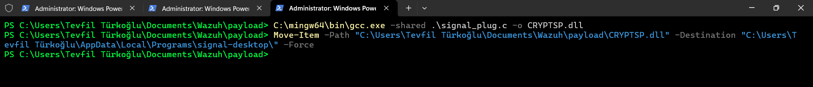
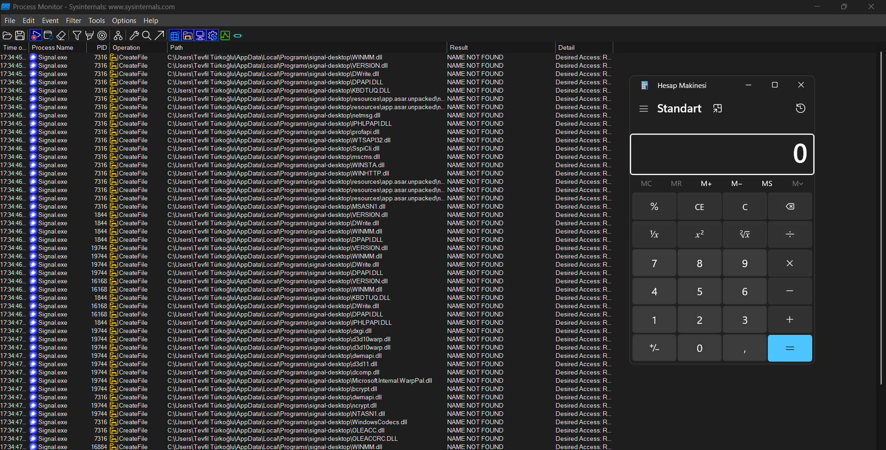
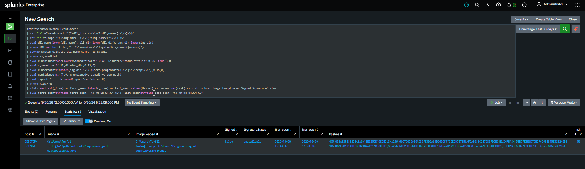

# T1574.001 · DLL Side-Loading

## 1. Scenario

Signal is a legitimate application that loads DLLs during startup. The lab demonstrates DLL side-loading by placing a crafted `cryptsp.dll` in the directory from which Signal resolves its DLL dependencies. The DLL exports the expected CryptSP functions by forwarding them to the legitimate copy in `C:\Windows\System32`, while its `DllMain` starts a thread that launches `calc.exe` when Signal loads it.

The key condition is that the target directory is writable by the current user. The malicious DLL was placed in the directory observed during process monitoring where Signal attempted to load it; this was possible because the location was not the protected `System32` directory. On the next Signal launch, Windows resolved the dependency to the planted DLL, and the payload ran in the context of Signal.

## 2. Lab Setup

| Component | Detail |
|---|---|
| Target application | Signal Desktop |
| Endpoint telemetry | Sysmon Image Load events (EventCode 7), observed with Process Monitor |
| Detection platform | Splunk |
| Payload source | [`signal_plug.c`](../../payload/signal_plug.c) |
| Detection rule | [`dls-side-loading.spl`](../../Rules/Splunk-SPL/Execution/dls-side-loading.spl) |

## 3. Attack Chain

| Stage | Action | Evidence |
|---|---|---|
| 1. Identify dependency lookup | Observe Signal startup in Process Monitor and identify the directory where the required DLL is searched for | Initial `NAME NOT FOUND` result in the DLL search path |
| 2. Build the payload | Compile the crafted DLL from `signal_plug.c` | DLL forwards `CryptAcquireContextW` and `CryptReleaseContext` to the legitimate System32 `cryptsp.dll`; process attach starts a thread that runs Calculator |
| 3. Stage the DLL | Place the compiled DLL in the observed, user-writable application directory | The directory is writable because it is not the protected System32 location |
| 4. Trigger the load | Restart Signal while watching its DLL loads | The planted DLL is loaded instead of producing the earlier `NAME NOT FOUND` result |
| 5. Confirm execution | Observe Calculator start after Signal loads the DLL | Confirms the DLL entry point payload executed |
| 6. Detect | Search the Sysmon Image Load telemetry in Splunk | The side-loading SPL produces a risk-scored result for the suspicious load |

## 4. Payload Behavior

The payload preserves the exports Signal expects by forwarding the two CryptSP functions to `C:\Windows\System32\cryptsp`. Its `DllMain` handles `DLL_PROCESS_ATTACH` by creating a thread, which calls `WinExec("calc.exe", SW_SHOW)`. This allows Signal to continue loading while providing a visible proof that the attacker-controlled DLL code ran.

## 5. Detection Logic

The SPL searches Sysmon EventCode 7 in `windows_sysmon`. It extracts the loaded DLL name and directory, as well as the loading image's directory. It excludes DLLs loaded from the standard Windows system locations (`System32`, `SysWOW64`, and `WinSxS`), then uses `system_dlls.csv` to focus on known system DLL names loaded from elsewhere.

The rule assigns confidence from three contextual signals:

| Signal | Confidence contribution | Meaning |
|---|---:|---|
| DLL is unsigned | 0.40 | `Signed="false"` |
| Signature status is not valid | 0.25 | `SignatureStatus` differs from `Valid` |
| DLL and loading image share a directory | 0.25 | A common side-loading pattern |
| Loading image is under Users, ProgramData, or Temp | 0.15 | The executable is running from a potentially user-writable location |

Confidence is capped at 1.0. Impact is fixed at 70 and risk is calculated as `impact × confidence`, rounded to an integer. Results below risk 40 are discarded; the remaining events are grouped by host, executable, loaded DLL, and signature fields, with first and last seen times and hashes retained.

## 6. Validation

The four screenshots document the lab sequence: DLL creation/staging, Process Monitor observations, successful load and Calculator execution, and Splunk detection.

During the initial Process Monitor review, we identified DLL lookups that returned `NAME NOT FOUND`. These events revealed the directory in which Signal attempted to locate the missing dependency.

We then placed the custom DLL in the directory identified during the Process Monitor review, where the current user had permission to write.

After Signal was restarted, it loaded the custom DLL and continued running. Process Monitor no longer reported `cryptsp.dll` as `NAME NOT FOUND`, and the DLL payload launched `calc.exe`, confirming that the code executed.

Finally, we used the custom Splunk search to identify the suspicious DLL load and surface the side-loading activity.

During the initial observation, Signal's DLL lookup showed `NAME NOT FOUND` for the dependency location. After staging the compiled DLL and restarting Signal, Process Monitor showed the DLL being loaded from that location. Calculator launched as the payload's visible execution marker, and Splunk identified the unusual system-DLL load using the rule's risk logic.

## 7. ATT&CK Mapping

| Technique | Relationship |
|---|---|
| [T1574.001](https://attack.mitre.org/techniques/T1574/001/) | Hijack Execution Flow: DLL — primary technique demonstrated by placing a malicious DLL where a legitimate application resolves a dependency |

## 8. Limitations

- The SPL depends on Sysmon Image Load events and the `system_dlls.csv` lookup being available and correctly populated.
- DLLs loaded from the explicitly excluded Windows system directories are outside this rule's scope.
- The rule's confidence is based on signature state, same-directory loading, and executable path. Legitimate applications can also load unsigned or locally stored DLLs, so the score requires environment-specific validation and triage.
- The lab validates one application and one DLL search path. Other applications may use different search behavior, require different exports, or fail to load a proxy DLL that does not match the expected interface.
- Calculator is a clear lab proof of execution, but this payload behavior is only a demonstration; an adversary could substitute another action.

